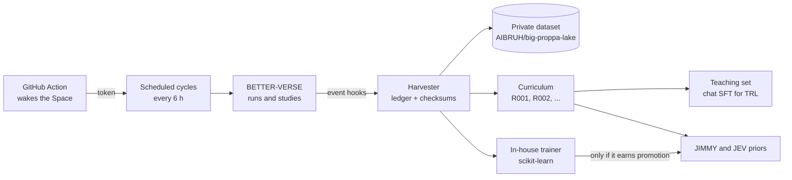

# MY BOO: data harvester, training curriculum and in-house JEV training

Back to the [README](../README.md) · [BETTER-VERSE](BETTER-VERSE.md) · [Playbook](PLAYBOOK.md)

**Everything BETTER-VERSE produces goes to MY BOO, automatically.** She collects every session (run), every individual better, every slip and every
leg; packages it into numbered, itemized **curriculum releases**; and trains JEV in house. Nothing waits for a person to click.

## 1. The harvester (`backend/boo_harvest.py`): collection that never waits

| Trigger | What happens |
|---|---|
| **Event: a run is written** | `betterverse_sim._write` calls the harvester. It checksums the run, records its legs/slips/betters, updates the **crowd counters** (how often each board leg was picked, by tier, across every run) and mirrors the run to the private dataset. |
| **Event: a study is written** | `betterverse_study._write` calls it. The study becomes curriculum evidence and a release is cut if anything changed; it is mirrored too. |
| **Startup** | The worker backfills anything on disk that the ledger has not seen and retries any mirror that failed. |
| **Schedule** | Every `HARVEST_EVERY_MIN` minutes (default 360) a **cycle** runs: `HARVEST_UNIVERSES` (3) fresh universes × every real season × 150 betters, collected; a Strategy Lab study every 4th cycle (a new seed each time, so it is *replication evidence*); in-house JEV training every 6th cycle. |
| **Weekly** | The Tuesday 6 AM Central batch also cuts a curriculum release if new evidence changed anything. |
| **External** | `POST /api/myboo/harvest/cycle` with header `X-Harvest-Token` starts a cycle. The scheduled GitHub Action `.github/workflows/boo-harvest.yml` calls it every 6 hours, which also **wakes a sleeping free Space**. |

Why both the in-app schedule and the Action: a free Hugging Face Space sleeps when idle, and a sleeping app cannot run its own timer. The Action
is the trigger that cannot sleep.

**Obsessive by design.** Every item is checksummed and idempotent (re-harvesting is a no-op), logged in `lake/gold/nfl/boo_harvest/ledger.jsonl`, and
**queued for retry** if the dataset mirror is unreachable, so a network failure delays collection but never loses it. The Space's disk is
ephemeral; the private dataset is the durable copy, and the ledger, curriculum and models are restored from it on startup.

**What is collected, per run:** every leg (market, side, line, price, actual, hit, void, tier, same-game flag), every slip (legs, shape, odds, stake,
payout, bankroll before/after), and every better (username, tier, ideology, rules, base bet, ROI, proof, ranks, drawdown). Per study: the full study.

### Setup you must do once

| Where | Secret | Value |
|---|---|---|
| Hugging Face Space → Settings → Variables and secrets | `HARVEST_TOKEN` | any long random string |
| Hugging Face Space | `HF_TOKEN` | already used by MY BOO's mirror (needs write access to `AIBRUH/big-proppa-lake`) |
| GitHub repo → Settings → Secrets and variables → Actions | `HARVEST_URL` | `https://aibruh-big-proppa-live.hf.space` |
| GitHub repo | `HARVEST_TOKEN` | the same string as on the Space |

Scheduled workflows run only from the repo's default branch, so the Action starts after this is merged to `main`. Switches: `BOO_HARVEST=0` turns every
trigger off; `AUTOHARVEST=0` turns off only the scheduled cycles; `HARVEST_EVERY_MIN`, `HARVEST_UNIVERSES`, `HARVEST_BETTERS`, `HARVEST_STUDY_EVERY`
and `HARVEST_STUDY_UNIVERSES` tune the cadence. Status: `GET /api/myboo/harvest/status` and MY BOO → **CURRICULUM** tab.

## 2. The curriculum (`backend/boo_curriculum.py`): itemized, numbered releases

Each study is filed as evidence. The same strategy or slip shape across studies is pooled and **graded by explicit rules**:

| Verdict | Rule |
|---|---|
| **Teach** | ≥ 60% chance of profit in **every tested season** (and ≥ 50% in every study), in profit in each season, hit rate above the price-implied probability, ≥ 1,000 slips |
| **Watch** | ≥ 30% chance of profit in every season |
| **Fragile** | Profitable overall (95% range above zero) but it **lost money in at least one season** |
| **Avoid** | Confident loser: the whole 95% range is below zero, ≥ 1,000 slips |
| **Benchmark** | Reference facts: legs per slip, same-game vs cross-game, tiers |
| **Case** | A big winner and why that win is not a template |

A release is a snapshot in six units (Foundations · Parlay types that hold up · Watch list · Fragile · Traps to avoid · When rookies win), with what
changed since the last one (**new / promoted / demoted / updated / retired**), release notes (`.md`) and flat training rows (`.jsonl`, schema
`boo.curriculum.lesson.v1`). A release is cut only when something changed. A study that tests more seasons **supersedes** an older study with the same
universes and seed, so shared data is never double counted.

### The first two releases are the proof it works

| Release | Evidence | Teach | Watch | Fragile | Avoid |
|---|---|---|---|---|---|
| **R001** | 20×150, 2024-25 | **5** (rush-yards unders ×2 and ×3, game-total overs ×2 and ×3, Edge Hunter · Sharp) | 7 | 1 | 32 |
| **R002** | same universes, **plus 2023** | **0** | 1 | 3 | 36 |

R002 **demoted** the rush-yards unders to *Fragile* ("+4.9% overall, but 2023 -18%") and **retired** 14 lessons that no longer qualify. The curriculum
caught a pattern that did not survive a third season, which is exactly why a lesson must replicate before it is taught.

API: `GET /api/myboo/curriculum` · `…/{release}` · `…/{release}/notes` · `…/{release}/training.jsonl` · `…/{release}/sft.jsonl` ·
`POST /api/myboo/curriculum/ingest/{study_id}` · `POST /api/myboo/curriculum/release`. Sending a study to MY BOO from the Strategy Lab does all of it.

## 3. In-house JEV training (`backend/boo_jev_trainer.py`)

- **Tool:** [scikit-learn](https://github.com/scikit-learn/scikit-learn) `HistGradientBoostingClassifier`, small and regularised. It trains on CPU in seconds, so
  it runs inside the Space.
- **Data:** every graded leg on the board for 2023-25 (about 55,000), with leak-free pre-game features (the player's last-six form, how far the line sits
  from it, spread and total, price and no-vig price) plus the **crowd counters** the harvester accumulates.
- **Honest evaluation:** leave-one-season-out. For each real season the model trains on the other two and is scored on the one it never saw (Brier score,
  log loss, and the ROI of betting its biggest-edge legs at their listed price) against the price's own no-vig probability.
- **Promotion gate:** a model is **promoted** only if it beats the baseline on Brier **and** its top-edge legs are profitable in **every** held-out
  season. Otherwise it stays on file and is not used. `load_promoted()` is the only way JEV can reach a model.
- **First run (2026-10-14):** Brier gain +0.0025 (2023), +0.00044 (2024), +0.0015 (2025); top-edge legs returned +14.2%, +11.7%, +5.7%. It missed the strict
  Brier gate in 2024, so **not promoted**.
- **Important caveat:** BETTER-VERSE prop lines are **synthetic** (a player's recent median, shaded), not historical sportsbook lines, which we do not have for
  2023-25. A model can learn how that synthetic book differs from better information without that being an edge against a real book that already prices
  matchup and game script. Passing the gate is *necessary, not sufficient*: before any model touches live JEV scoring it must be validated against real
  historical lines. For that reason the trainer is **not wired into live JEV scoring yet**.
- **Teaching a language model:** `GET /api/myboo/curriculum/{release}/sft.jsonl` exports the curriculum as chat-format examples (`messages`) ready for
  [Hugging Face TRL](https://github.com/huggingface/trl)'s `SFTTrainer`, for when JIMMY or JEV need fine-tuning on a GPU. Training an LLM needs a GPU, so
  that step is not run inside the Space.

Models and reports live in `lake/gold/nfl/boo_models/` (mirrored to the dataset). Status: `GET /api/myboo/jev-model`.

## What is not done yet

- The promoted-model hook into live JEV/JIMMY scoring (waiting on validation against real historical lines).
- Collecting the human JIMMY season-game sessions into the same harvester (the same ledger and mirror would work).
- Real hourly cadence on a sleeping Space depends on the GitHub Action secrets above being set and the branch being merged.

## Train JIMMY: numbered updates

The **TRAIN JIMMY** button at the top of the MY BOO CURRICULUM tab (`POST /api/jimmy/updates/send`) packages the latest curriculum release and sends JIMMY an
update numbered `JU-000N`. Each change inside it is an item numbered `JU-000N.NN` (a prop direction such as "rec-yds unders", or a slip size).

- **Every item is tested out of sample**: each real season (2023, 2024, 2025) is scored using only items learned from the other two, over up to 5 non-overlapping slips a week from JIMMY's real 16-prop board ($5, payout 2^legs).
- An item is **APPLIED** only if ROI and leg hit rate do not drop and one improves; otherwise it is **HELD**.
- The timeline shows win %, leg hit % and ROI per update with the change vs the previous one, plus JIMMY's live results per version (every season JIMMY plays is stamped with the version live at the time).
- Files: `lake/gold/nfl/boo_jimmy/{policy.json,timeline.json,live.jsonl,updates/JU-000N.{json,md,jsonl}}`. API: `GET /api/jimmy/updates`, `/api/jimmy/updates/{id}`, `/notes`, `/items.jsonl`, `GET /api/jimmy/recommend/{session}`.
- Baseline JU-0000 (top 3 confidence overs): 15.2% win, 48.2% leg hit, +0.7% ROI. JU-0001 (rec-yds unders applied; rush-yds and receptions unders held): 20.0% win, 53.6% leg hit out of sample.
- Caveat: the flat 2^legs payout is generous and the sample is about 270 slips, so treat gains as directional until JIMMY's live seasons confirm them.
