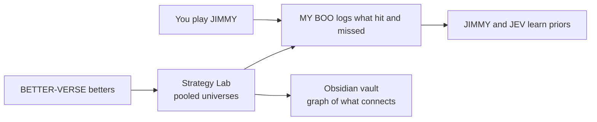

# Playbook: how to play, and how to read the data

Back to the [README](../README.md) · [BETTER-VERSE write-up](BETTER-VERSE.md)

Two things to do here, and a guide to understanding what the numbers mean:

1. **Play a season yourself** in the JIMMY game (`/jimmy`).
2. **Watch a town of simulated betters** and find out which strategies really make money (`/betterverse`).
3. **Read the data without fooling yourself.** Skip to [Reading the data](#reading-the-data) if you only want that.

---

## 1. Play it yourself: the JIMMY season game

**Where:** `/jimmy` on the live site. You travel back to Friday of Week 1 of the 2024 or 2025 NFL season with no knowledge of how it ends.

### The rules

| Rule | Detail |
|---|---|
| Season | Pick **2024** or **2025**. Real results grade every leg. |
| Slips per week | Choose **1 to 5**. It is locked for the whole season. |
| Bankroll | You start with **$100**. Hit $0 and the season ends. |
| Wager | **$5** a slip; **$10** once your bankroll reaches $500; **$15** at $1,000. |
| Building a slip | **1 to 5 legs**. Each leg is a player prop shown as `O 67.5` (over) or `U 67.5` (under). No two legs can be the same player and prop. |
| The lines | Built only from games already played, so there is no peeking. |
| Payout | If every leg hits, the slip pays **wager × 2 per leg** (2 legs = 4×, 3 legs = 8×, 5 legs = 32×). One miss loses the wager. |
| Voids | A player who did not play drops out of the slip. If every leg voids you get the stake back. |
| Advancing | Place at least one slip, then **Advance Week**. After Week 17 the button becomes **Finish Season**. |
| The booth | After each week MY BOO, Jonah Jacques and Julian Feltus break it down and make a pick. **Tail** one for next week: if their pick hits you get a bonus of one wager unit. You must watch the recap first. |
| Auto-Play | A switch on the season screen. JIMMY builds the slips and advances weeks while you watch. |

### How the payout shapes your strategy

The payout is a flat 2× per leg no matter how likely the leg was, so **each leg needs to hit more than 50% of the time to be worth adding**. Your expected return on a slip is `(2 × chance per leg) ^ legs`. At 50% per leg that is exactly 1.0 (break-even); at 45% it is 0.9 per leg and shrinks with every leg you add.

### What the data says about the game's own board

A check of **519 board props** across both seasons (small sample, so treat these as hints, not laws):

| Prop | Over hit rate | Read |
|---|---|---|
| Rush yds | 56.5% | Overs held up |
| Pass yds | 53.2% | Slight edge to overs |
| Receptions | 43.2% | **Unders** hit about 57% |
| Rec yds | 42.0% | **Unders** hit about 58% |
| All props | 48.7% | Just under the 50% break-even |

- **The confidence number is not a promise.** Legs scored 60 hit 50.8% as overs and legs scored 70 hit 46.7%. Do not stack legs just because the score is high.
- With about 120-140 legs per prop type the margin of error is roughly ±8 points, so a 57% under is encouraging, not proven.

### Tips from the Strategy Lab (real prices, 6,000 bettor-seasons)

These come from BETTER-VERSE, which uses real sportsbook-style prices rather than the game's flat 2×, but the lessons carry over:

1. **Keep slips short.** 2-leg slips lost 8.7% of the money bet, 3-leg 12.6%, and **6+ legs lost 74% to 89%**. Every added leg multiplies the house's cut.
2. **Cross-game beats same-game.** Same-game parlays lost 46.8% vs 16.1% for cross-game slips.
3. **Game-total overs were the one profit the data supports** (Overs Only · Grinder +9.8%, 95% range +2.0% to +17.3%), but 2025 was flat for them (-0.4%), so the chance of profit in both seasons is only 43%, and part of it reflects how 2024-25 played out.
4. **The most consistent parlay types** (best chance of profit in *both* seasons): **2-leg rushing-yards unders** (80%; 34% of slips hit vs 29% implied by the price), **3-leg game-total overs** (70%) and **2-leg game-total overs** (66%).
5. **Do not chase a long anytime-TD ticket.** The biggest single winners hit 4-5 leg anytime-TD tickets at roughly 150× to over 700×, yet TD Scorer Stackers lost money overall (-17% to -39%).
6. **Flat small bets beat chasing.** Doubling up after a losing week is how the Degens ended at -34.7% on average vs -2.9% for the Sharps.

---

## 2. Watch it: BETTER-VERSE

**Where:** `/betterverse`.

- **Run a season.** Pick 2024, 2025 or both (the *Career* view). Each of the betters has a username, a skill tier and a stated ideology.
- **Tiers.** *Sharp* researches which markets beat the book; *Grinder* has a favorite bet but bets like a pro; *Casual* goes with their gut; *Degen* chases losses and builds long parlays.
- **Table limits.** Everyone starts with $100 and picks a **$5 or $10** base bet. Max bet is **$10 until $500, $20 until $1,000, then free**.
- **Leaderboard.** *Winnings* ranks real money with nothing filtered, so a lucky rookie ranks where the money puts them. *Luck-adjusted* ranks the ROI a better would still have had on a bad-luck replay of their own slips.
- **Deep dive.** Click any better for their ideology, rules, bankroll curve, what they actually bet, and every slip.
- **Strategy Lab.** Pools many universes across both real seasons and says which strategies make money. See the next section.

---

## Reading the data

### The four numbers that matter

| Number | What it tells you | Trap |
|---|---|---|
| **ROI** | Profit per $1 staked. +10% = $10 won per $100 bet. | A single big win can swing it. |
| **Hit rate** | How often the whole slip cashes. | A high hit rate with low payouts still loses (favorites on the moneyline). |
| **Profit per slip** | Dollars won or lost per slip on average. | Depends on stake size. |
| **Bettor-seasons in profit** | Share of betters who finished above $100. | Ignores how much they made. |

### The Strategy Lab table

- **The bar** is the **95% range** of ROI (a bootstrap over bettor-seasons). The thin line marks break-even.
  - Whole bar **right** of the line = **proven money-maker** (`proven $` flag).
  - Whole bar **left** = a **confident loser**.
  - Bar **crossing** the line = not proven either way. This is the usual case, so do not over-read the number in the middle.
- **`$ both seasons`** means it was in profit in 2024 *and* 2025. A strategy that only worked one year probably fit that year's luck.
- **`beat field`** only means it lost less than the average better in both seasons. It is not a profit.
- **The 2024 and 2025 columns** are the quickest sanity check. If one is +40% and the other is -7%, do not trust it.

### The probability ranking: which kinds of parlay win most

The Strategy Lab ranks every strategy and every slip shape by **how likely it is to make money**, using probabilities you can apply to your own slips:

| Measure | What it means |
|---|---|
| **P(profit), both seasons** | The headline rank. Each real season is replayed 300 times on its own (resampling the betters' results); take the share of replays in profit for 2024 and for 2025, then multiply. A parlay type that won big in one year and lost in the other scores low. |
| **P(profit), overall** | Same idea on all the data pooled. |
| **P(beat the field)** | Chance the strategy does better than the average better. |
| **Slip hit probability** | How often the whole slip cashes, with a 95% range (Wilson interval). |
| **Probability the price implies** | `1 ÷ decimal odds`. If the real hit probability sits **above** this, the price was too long and the slip had an edge; below it, the book's margin wins. |
| **Edge in points** | Hit probability minus the price-implied probability. |

How to apply them: when you build a slip, find its shape in the ranking and compare. A shape with a high P(profit) **and** a hit rate above its price-implied probability (for example 2-leg rushing-yards unders: 34% of slips hit vs 29% implied, 80% chance of profit in both seasons) is a better template than one that hits rarely and pays a lot (5-leg favorite spreads: +16.8% ROI overall, but +43% in 2024 and -7% in 2025, so only a 36% chance of profit in both seasons).

### Worked examples (20 universes × 150 betters × 2 seasons)

| Strategy | ROI | 95% range | P(profit) both seasons | Verdict |
|---|---|---|---|---|
| Overs Only · Grinder | +9.8% | +2.0% to +17.3% | 43% | **Proven profit**, but 2025 was flat, so not consistent. |
| Overs Only · Degen | +3.5% | -12.8% to +18.6% | 30% | Not proven. Same bet, sloppier bankroll, noisier. |
| Edge Hunter · Sharp | -2.9% | -6.0% to -0.2% | 1% | Loses the least of any researcher, but still a small confident loser. |
| TD Scorer Stacker · Casual | -39.4% | -54.0% to -27.7% | 0% | **Confident loser**, even though it produced the biggest single wins. |
| Lottery Ticket · Degen | -73.8% | -83.1% to -64.7% | 0% | **Confident loser**; 1% of slips hit. |

The house kept about **19.6%** of every dollar staked (14.8% in 2024, 24.3% in 2025). That is the hole every strategy has to climb out of.

### Habits that keep you honest

1. **A big winner is a story, not proof.** The biggest rookie winners hit anytime-TD lottery tickets. Open their deep dive, then look at the strategy's overall ROI.
2. **Sample size.** The Lab leaves out any strategy with fewer than 150 slips, and even above that a wide bar means there isn't enough data yet.
3. **One universe is one roster.** Always read the Strategy Lab, not a single run's leaderboard, to judge a strategy.
4. **Same two seasons.** Extra universes average out the betters' randomness, **not** what really happened in 2024-25. Prefer strategies that win in both seasons.
5. **Compare ROI, not dollars.** A $10 better earns twice the dollars of a $5 better at the same ROI.
6. **Look for what never cashed.** The *Never cashed* and *Money losers* lists are as useful as the winners: they tell you what to stop building.
7. **Check the legs.** On the *Every leg vs the book's price* chart, bars right of center beat the price. Unders on volume props (rush yards, receptions) tended to, while receiving-yard overs did not.

### Slip-shape notation

`anytime_td:yes x3` means 3 anytime-TD legs. `ml:fav|spread:dog` is a favorite moneyline plus an underdog spread. `+SGP` at the end means at least two legs came from one game. The vault and the page show these in plain words (for example *Game Total over x2*).

---

## 3. See the connections: the Obsidian vault

The Strategy Lab can export its report as an **Obsidian vault**: a folder of linked notes so you can *see* how tiers, strategies, slip shapes and winners connect.

1. In the Strategy Lab click **Download Obsidian vault** (or `GET /api/betterverse/study/<study_id>/obsidian`).
2. Unzip it.
3. In Obsidian choose **Open folder as vault** and pick the `BETTER-VERSE Vault` folder.
4. Open `00 Home`, then press **Ctrl/Cmd+G** for **Graph view**.

**What you get**

| Folder | What's inside |
|---|---|
| `Tiers/` | Sharp, Grinder, Casual, Degen with a chart of each tier's styles |
| `Styles/` | The 13 betting styles |
| `Strategies/` | Every style × tier with its metrics, verdict and the slip shapes it builds |
| `Shapes/` | The 60 most-played slip shapes and which strategies build them |
| `Betters/` | The biggest winners, linked to their tier, style and the slip that won |
| `Rankings/` | **Which kinds of parlay win most**: Parlay Shape Ranking, Strategy Ranking and Top Parlays, each with charts (chance of profit, hit probability vs the price-implied probability, a hit-rate vs profit quadrant) and a full probability table |
| `Findings/` | Money makers, money losers, legs per slip, same-game vs cross-game (with charts) |
| `Glossary` | Plain-language definitions |

**Reading the graph.** Node colors are pre-set: **bright yellow** = a top-5 parlay shape or strategy by probability of profit, **gold** = proven money-maker, **red** = confident loser, **white** = an individual winning better, **violet** = a slip shape, and blue / green / amber / coral for the Sharp / Grinder / Casual / Degen tiers. Look for the yellow and gold nodes: `Rankings/Top Parlays` links to the best ones. Follow their links to the slip shapes they use, and to the betters who won with similar shapes. Notes also carry numeric properties (`roi`, `ci_lo`, `ci_hi`, `slips`, `p_both_seasons`, `hit_prob`, `implied`, `rank`) that you can filter or sort in Obsidian.

Charts are Mermaid blocks, which Obsidian renders natively in recent versions (1.5+). Each chart sits beside a plain table, so nothing is lost if your version does not draw it.

To regenerate from the command line: `cd backend && python betterverse_obsidian.py <study_id> <output_folder>`.

---

## Glossary

- **ROI**: profit per $1 staked.
- **P(profit)**: the probability, from resampling, that a strategy makes money; the headline version is for both real seasons together.
- **Implied probability**: the chance a price says an outcome has, `1 ÷ decimal odds`.
- **95% range**: where ROI would land about 95 times in 100 reruns. Entirely above 0 = proven; entirely below 0 = a confident loser.
- **Hold**: the share of every dollar the house keeps.
- **SGP**: same-game parlay. Books pay it less than the plain product of the leg odds because the legs move together.
- **Universe**: one roster of betters with their own random picks. The Strategy Lab pools many.
- **Slip shape**: the structure of a slip without the players.
- **Tier**: Sharp, Grinder, Casual or Degen.
- **Table limits**: $5/$10 base bets; max $10 until $500, $20 until $1,000, then free.
- **Tail**: bet the booth host's pick for next week; a hit pays a one-wager bonus.
- **Void**: a leg whose player did not play. It drops out of the slip.
